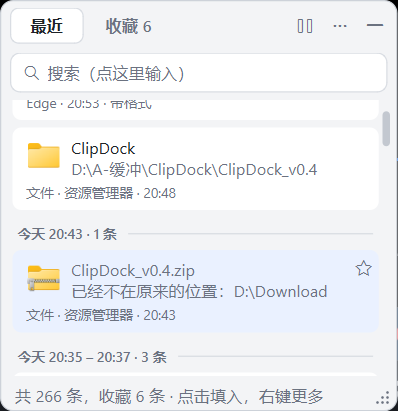

# ClipDock

常驻手边的 Windows 剪贴板工作台——呼出一次，连续点、连续填，绝不抢走输入焦点。



## 有什么用？

系统自带的 `Win+V` 是“用一次、关一次”的临时弹窗；**ClipDock** 则是悬浮在手边的常驻工作台，专为高频复制粘贴设计：

| 对比项 | Windows 自带 (`Win+V`) | ClipDock |
| :--- | :--- | :--- |
| **粘贴体验** | 粘一条就关闭，需反复呼出 | 悬浮常驻且**不抢焦点**，可一条接一条连续点击填入 |
| **呼出位置** | 固定在光标处，易遮挡内容 | 智能贴靠窗口外侧或光标上下方，自动避让输入法 |
| **内容整理** | 仅支持简单固定，重启清空 | 支持**收藏、项目分类**，5 分钟内的连续复制自动分组 |
| **搜索与反馈** | 无搜索，复制成功无提示 | 支持内容/来源程序搜索；复制成功时鼠标旁弹出 `✓ 已复制` |
| **存储上限** | 最多 25 条 | 本地 SQLite 存储（默认 500 条），收藏内容永久保留 |

**核心亮点：**
* **全格式支持**：自动记录纯文本、富文本（保留 Word/网页格式）、截图/图片以及本地文件路径。
* **智能防打扰**：玩游戏、看视频或放 PPT 等全屏场景下自动隐藏，退出全屏后自动恢复。
* **隐私与安全**：纯本地运行不联网；自动遵守系统隐私标记（如密码管理器复制的内容不会被记录），支持开启“关机时自动清空历史”。

---

## 适合谁用？

* **资料整理与写作者**：写论文、做调研时，需要先从各处连续复制多段素材，再集中粘贴排版。
* **高频填表与客服/运营**：日常需要频繁调用常用话术、链接、截图或文件，通过“收藏 + 项目分组”实现秒级回复。
* **开发者与效率工具控**：受够了系统剪贴板“不能搜索、粘一次关一次、重启丢失”的繁琐体验。

---

## 如何使用？

### 1. 安装与启动
1. 确保已安装 **Python 3.9+**（安装时勾选 `Add python.exe to PATH`）。
2. 在项目根目录打开终端，安装依赖：
   ```bash
   pip install -r requirements.txt
   ```
3. 双击 **`run.bat`** 启动（任务栏托盘将出现蓝色剪贴板图标）。
   > 如需打包为独立可执行文件，双击 **`build.bat`** 即可在 `dist\ClipDock.exe` 生成单文件版。

### 2. 日常操作
* **呼出面板**：按 **`Win + Alt + V`**（面板已打开时再次按下，可将其移动到当前光标附近）。
* **连续粘贴**：直接**左键点击**任意条目，内容会自动填入当前光标所在的输入框。
* **隐藏面板**：鼠标悬停在面板上按 **`Esc`**，或点击面板右上角 `—` / 托盘图标。
* **搜索与筛选**：点击搜索框直接输入关键词（空格分隔多词），支持直接搜来源程序名（如 `微信`、`Chrome`）；使用 `↑` `↓` 选择，回车填入。
* **整理与管理**：点击卡片右上角 `☆` 收藏；右键卡片可进行“仅复制、移入项目、删除”等操作。

### 3. 个性化配置
点击面板顶栏 **`···`** 菜单，可随时切换呼出位置（跟随光标 / 上次位置）、调节背景透明度、设置开机自启或清空历史。

如需修改默认快捷键（`hotkey`）或历史保留上限（`max_items`），可编辑首次运行生成的配置文件，保存后重启生效：
```text
%APPDATA%\ClipDock\config.json
```

> **使用提示**：受 Windows 安全机制限制，当目标程序以“管理员身份”运行时，普通权限的 ClipDock 无法向其自动模拟粘贴（此时条目会放入剪贴板并提示手动 `Ctrl+V`，或同样以管理员身份运行 ClipDock 即可）。