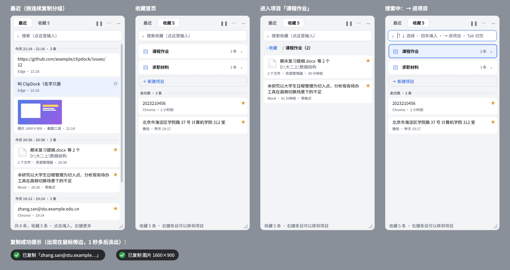
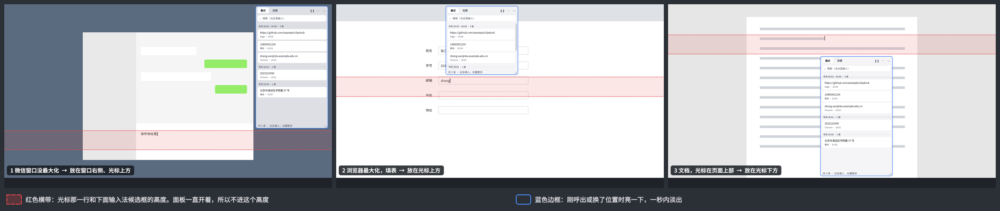

# ClipDock · 常驻剪贴板工作台（Windows）

Win+V 是“用一次、开一次”的剪贴板历史；ClipDock 是一直开在手边的剪贴板工作台——呼出一次，连续点、连续填。



（预览图里的小图标是替代字符，在 Windows 上会显示成系统图标。）

## 和 Win+V 的区别

| | Win+V 剪贴板历史 | ClipDock |
|---|---|---|
| 出现方式 | 临时弹出，粘一条就关 | 呼出到输入光标旁边，之后一直浮在最上层，全屏时自动让开 |
| 一次呼出能填几条 | 一条 | 任意条，一条接一条点 |
| 点击时的焦点 | — | 不抢焦点，光标一直留在你的输入框里 |
| 复制成功了吗 | 不提示 | 鼠标旁边提示“✓ 已复制 …” |
| 保存 | 最多 25 条，重启清空（固定的除外） | 默认 500 条，存在本机，重启不丢；收藏的永久保留 |
| 整理 | 只能固定 | 收藏 + 项目分类；最近的按“连续复制”自动分组 |
| 查找 | 没有历史搜索 | 按内容或来源程序搜索，支持多个关键词 |
| 来源 | 不显示 | 显示从哪个程序复制、什么时候 |

## 运行

1. 安装 Python 3.9 或更新版本（python.org 下载，安装时勾选 **Add python.exe to PATH**）
2. 在本文件夹打开终端，安装依赖：
   ```
   pip install -r requirements.txt
   ```
3. 双击 `run.bat`。面板会出现在屏幕右侧，托盘区会有一个蓝色的剪贴板图标。

出问题时双击 `debug.bat`，可以在黑窗口里看到报错；日志在 `%APPDATA%\ClipDock\clipdock.log`。

## 怎么用

**基本操作**

- **Win+Alt+V**：呼出面板（快捷键可以改，见“配置”）。默认出现在输入光标旁边；面板已经开着时，按一下就挪到你现在打字的地方。
  快捷键只负责呼出，不再用来隐藏。隐藏面板：鼠标停在面板上按 Esc，或者点面板右上角的 —，或者点托盘图标。
- **点一条**：填进你当前光标所在的输入框。面板不抢焦点，所以可以一条接一条地点。
- **Esc**：鼠标停在面板上时按 Esc 隐藏面板。鼠标不在面板上时，Esc 照常给别的程序用；搜索时 Esc 先取消搜索。
- **右键一条**：填入 / 仅复制 / 收藏 / 移到项目 / 删除（文件还可以“复制文件路径”）。
- **搜索**：点搜索框直接打字，多个关键词用空格分开，也能搜来源程序（比如“微信”）。↑↓ 选择，回车填入，Esc 取消。
- 拖动顶栏移动面板，拖右下角调整大小，位置会自动记住。

**呼出位置（菜单 ··· 里二选一）**

- **出现在输入光标旁边**（默认）：按 Win+Alt+V 时，面板出现在你正在打字的地方附近。
  面板呼出后会一直开着，所以**不和光标在同一高度**：那一行你还要接着往右写，中文输入法的候选框也在光标正下方。
  按下面的顺序挑，第一个放得下的就用：
  1. 当前窗口没最大化、旁边有空位、离光标又不远：贴在**窗口外侧**（同样避开光标那一行），不挡这个程序的任何内容，比如微信聊天窗口旁边。
  2. 光标那一行的**上方**，左边和光标对齐，像下拉菜单一样。接着写的内容往右、往下长，表单里下面是还没填的格子，上方挡住的只是已经写完、填完的。
  3. 上方放不下，放到**下方**，让开输入法候选框。
  4. 只有屏幕太矮、上下都放不下时，才放到同一高度的旁边。

  地方不够时面板会临时变矮（最矮 300，大约能看到 4 条）。你拖出来的大小会一直记住，“上次的位置”模式下也按你的大小。
  面板已经在光标那一行上方或下方不远处时，再按快捷键它不会动，免得跳来跳去。
  面板挪到新位置时边框会亮一下，方便一眼找到。少数程序不告诉别人光标在哪，这时面板放在鼠标旁边，底部会提示。
- **出现在上次的位置**：面板在哪儿隐藏的，就在哪儿出现，不跟着光标走。



**复制成功提示**

在任何程序里复制（Ctrl+C、右键复制、截图工具复制都算），鼠标旁边会出现一秒多的小提示：
`✓ 已复制「张三」`、`✓ 已复制 图片 1920×1080`、`✓ 已复制 报告.docx`。没有出现提示，就说明这次没复制上。
不想要可以在菜单里关掉“复制成功提示”。全屏程序在前台时不弹提示（内容照常记录）。

**文字、图片、文件**

- 文字：从 Word、网页复制的带格式文字会连格式一起保存，填进 Word 等支持格式的地方时保留加粗、链接等；卡片上标“带格式”。
- 图片：截图、网页上“复制图片”、微信里复制的图片都会记录，卡片上显示缩略图，点一下把图片粘贴进去。
- 文件：在资源管理器里复制的文件（可以多个）会记录路径，点一下等于在目标文件夹里按 Ctrl+V 粘贴文件。
  文件被移走或删掉后，卡片上会写“已经不在原来的位置”。网络路径不做检查，免得断网时卡住。

**最近：按连续复制分组**

“最近”页里，前后间隔不超过 5 分钟的复制会归成一组，组标题写着时间段和条数，比如 `今天 14:02 – 14:10 · 4 条`。
写作业时连续复制的一批资料会挨在一起。间隔可以在配置里改（`group_gap_minutes`）。

**收藏与项目**

- 鼠标移到卡片上，点右上角的 ☆ 就收藏了；再点一次取消。收藏的内容永久保留，不受条数上限和“清空历史”影响。
- 顶栏切到“收藏”页：上面是项目，下面是还没分类的收藏。
- 右键一条 → 移到项目，可以放进已有项目，或者直接“新建项目…”。
- 点项目进入，点左上角的“‹ 收藏”返回。用键盘时：点搜索框后 ↑↓ 选到项目，**→ 进入项目，← 返回**，Tab 在“最近”和“收藏”之间切换。
- 在“收藏”页搜索会搜全部收藏，结果里注明属于哪个项目。
- 右键项目可以重命名、删除。删除项目不会删除里面的收藏，它们会回到“未分类”。

**顶栏菜单（···）**

显示/隐藏面板 · 呼出位置（输入光标旁边 / 上次的位置）· 暂停记录 · 复制成功提示 · 新建项目 · 清空历史（保留收藏）· 关机时清除历史 · 背景透明度 · 开机启动 · 打开数据文件夹 · 退出。

**关机时清除历史（默认关闭）**

打开后，每次关机、重启或注销时清空历史记录，收藏的内容保留。
如果电脑是直接断电、没来得及清，下次启动 ClipDock 时会补清一次并提示。

**全屏与背景**

- 看视频、玩游戏、放 PPT 这类全屏程序在前台时，面板自动隐藏，退出全屏后自动回来；全屏时按快捷键可以强制呼出。
- 面板空白处默认半透明，可以在菜单 → 背景里选“不透明 / 微透明 / 半透明 / 较透明 / 很透明”。条目和搜索框始终不透明。

## 配置

第一次运行会生成 `%APPDATA%\ClipDock\config.json`，改完重启 ClipDock 生效：

| 项 | 默认值 | 说明 |
|---|---|---|
| `hotkey` | `"win+alt+v"` | 呼出面板的快捷键，例如 `"ctrl+alt+c"`、`"ctrl+shift+f12"`、``"alt+`"`` |
| `popup_position` | `"caret"` | 按快捷键时面板出现在哪：`"caret"` 输入光标旁边，`"last"` 上次的位置（菜单里也能切换） |
| `max_items` | `500` | 最多保留多少条未收藏的记录（收藏的不算） |
| `max_image_mb` | `300` | 未收藏的图片等数据最多占多少 MB，超出时从最旧的删起 |
| `max_text_chars` | `200000` | 单条超过这个字数就不记录（会提示“太大，没有记录”） |
| `copy_feedback` | `true` | 复制成功时在鼠标旁边提示 |
| `group_gap_minutes` | `5` | 两次复制间隔不超过这么多分钟，就归为同一组 |
| `clear_on_shutdown` | `false` | 关机/重启/注销时清空历史（收藏保留） |
| `hide_when_fullscreen` | `true` | 全屏程序在前台时自动隐藏 |
| `show_on_start` | `true` | 启动时显示面板 |
| `background_opacity` | `70` | 面板空白处的不透明度（%），100 为不透明，最低 10 |

## 隐私

- 记录只存在本机 `%APPDATA%\ClipDock\history.db`，不联网。删除的内容会在磁盘上抹掉，不只是标记删除。
- 遵守 Windows 的“不要记录”标记：密码管理器复制的密码不会被记录（Win+V 也遵守同样的标记），提示里会写“隐私内容，不记录”。
- 随时可以暂停记录、从菜单清空，或者打开“关机时清除历史”。

## 从旧版升级

直接替换文件即可，历史记录会自动升级：以前“固定”的条目变成“收藏”。

## 打包成 exe

双击 `build.bat`，完成后在 `dist\ClipDock.exe`，可以放到任意位置运行，菜单里能设置开机启动。

没有数字签名的 exe 第一次运行时，Windows 可能提示“已保护你的电脑”，点“更多信息 → 仍要运行”。
少数杀毒软件可能误报（同时监听剪贴板、模拟按键的程序容易被误判），这时用源码方式运行就行。

## 已知限制

- 目标程序以管理员身份运行时（比如管理员终端），Windows 不允许普通程序向它模拟按键。
  这时 ClipDock 会把内容放进剪贴板并提示你手动按 Ctrl+V；也可以把 ClipDock 也用管理员身份运行。
- 填入靠模拟 Ctrl+V，少数不用 Ctrl+V 粘贴的程序（比如 PuTTY）需要手动粘贴。
- 少数程序不告诉别人输入光标在哪（比如 JetBrains 系列 IDE、部分终端），“出现在输入光标旁边”时面板会放在鼠标旁边。
- 填入会替换剪贴板里当前的内容（和 Win+V 一样）。
- 文件只记录路径，不备份文件本身：原文件删了就填不进去了。
- 某些软件的私有格式（比如设计软件里复制的图层）无法记录，提示里只显示“已复制”。

## 它是怎么做到的

- **不抢焦点**：面板窗口加了 `WS_EX_NOACTIVATE` 样式，并且在 `WM_MOUSEACTIVATE` 消息里返回 `MA_NOACTIVATE`。
  点击时面板不会被激活，键盘焦点留在原来的输入框。见 `win32.make_no_activate()` 和 `ui.Panel.nativeEvent()`。
- **记录**：`AddClipboardFormatListener` 让系统在剪贴板变化时发来 `WM_CLIPBOARDUPDATE`；
  先检查 `ExcludeClipboardContentFromMonitorProcessing`、`CanIncludeInClipboardHistory` 这些隐私标记，
  再用 Qt 读出文字（连同 HTML/RTF 格式）、图片（存成 PNG 并生成缩略图）或文件路径。见 `clipdata.capture()`。
  剪贴板正被别的程序占用时会稍后重试，不会漏记。
- **找输入光标**：先用 `GetGUIThreadInfo` 问系统光标（记事本、Word 等传统程序会报告）；
  问不到再通过辅助功能接口（MSAA 的 `OBJID_CARET`）问，Chrome、Edge 和 VS Code、飞书这类 Electron 程序靠这个。
  后者放在后台线程里问，对方程序卡住时最多等 0.3 秒，没响应的程序直接跳过，不会把 ClipDock 卡住。见 `win32.caret_rect()`。
- **放在光标旁边哪里**：规则见上面“呼出位置”，代码在 `placement.py`，都是纯计算，有单独的测试。
  Windows 给的是物理像素，Qt 用的是按缩放比例换算后的坐标；多块屏幕缩放不同时，按各自的比例换算（`placement.native_to_logical()`）。
- **复制成功提示**：记录成功后，在鼠标旁边显示一个不抢焦点、鼠标可以穿透的小窗口，一秒多后淡出。见 `ui.CopyToast`。
- **填入**：先把内容（连同格式）放进剪贴板，再用 `SendInput` 模拟一次 Ctrl+V。见 `clipdata.build_mime()`、`win32.send_ctrl_v()`。
- **连续复制分组**：按时间从新到旧排好后，相邻两条间隔超过设定值就断开成新的一组。见 `ui.burst_groups()`。
- **收藏与项目**：都存在同一个 SQLite 数据库里（`items` 表的 `favorite`、`project_id` 两列）。见 `store.py`。
- **关机清除**：Windows 关机/注销时会发 `WM_QUERYENDSESSION`，Qt 把它转成 `commitDataRequest` 信号，ClipDock 在这时清空。
  另外每次启动时用 `GetTickCount64` 算出这次开机的时间，和上次记下的比，不一样就说明重启过，补清一次。
- **搜索**：面板不能被激活，也就没法打字。所以点搜索框时，会在同一位置弹出一个能激活的小输入框；
  选好之后先把焦点还给原来的窗口，再填入。
- **半透明**：窗口开了 Qt 的 `WA_TranslucentBackground`（Windows 上就是分层窗口），
  自己画一块带透明度的圆角底板，条目卡片和搜索框照常画成不透明。见 `ui.PanelBackground`。
- **Esc 隐藏**：面板不拿焦点，收不到按键；把 Esc 注册成全局快捷键又会抢走所有程序的 Esc。
  所以只在鼠标停在面板上时临时用 `RegisterHotKey` 注册 Esc，鼠标一离开就注销。见 `app.Controller._sync_esc_hotkey()`。
- **全屏让位**：每半秒看一次前台窗口是否铺满整块屏幕（排除桌面、任务栏和普通的最大化窗口）。
- **快捷键**：`RegisterHotKey`。松开 Alt/Win 时会补发一个无意义的按键，避免激活别的程序的菜单栏或弹出开始菜单。

## 代码结构

```
main.py               入口
clipdock/app.py       控制逻辑：记录、提示、填入、收藏与项目、搜索、全屏让位、关机清除、托盘和菜单
clipdock/ui.py        面板界面、条目绘制（文字/图片/文件/分组/项目）、搜索弹层、复制提示
clipdock/clipdata.py  剪贴板内容的识别与还原（文字、HTML/RTF、图片、文件）
clipdock/placement.py 按快捷键时面板放在输入光标旁边的哪里
clipdock/win32.py     Windows API（ctypes，不依赖 pywin32）
clipdock/store.py     SQLite：历史、收藏、项目
clipdock/config.py    配置文件
clipdock/hotkey.py    快捷键解析
tests/                测试（pip install pytest 后运行 python -m pytest）
```

`tests/test_win32_fake.py` 用一个“假的 Windows”把 Win32 调用流程跑了一遍，任何系统上都能运行，改 `win32.py` 后可以先跑它。
`tests/test_app_smoke.py` 在无窗口模式下跑完整的程序，模拟复制文字/图片/文件、点击填入、收藏、进出项目、关机清除、快捷键呼出到光标旁边。
